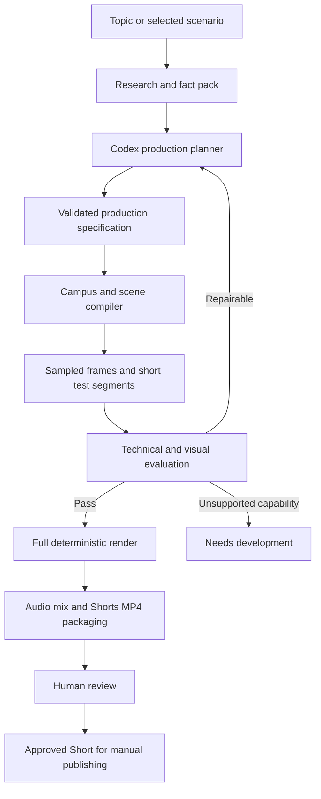

# AETHER — Technical Development Plan

Status: release implementation plan. A first V01 local MVP was implemented October 31, 2026; see [README.md](README.md) and [docs/MVP_STATUS.md](docs/MVP_STATUS.md) for actual scope and verification. The broader release gates below remain targets.

Project decisions and handoff notes: [CONTEXT.md](CONTEXT.md).

## 1. Direction and success criteria

Build AETHER as a **stylized 3D storytelling engine** that turns university hypotheticals into finished, reviewable YouTube Shorts.

The original proposal has a sound foundation: local rendering, deterministic animation, reusable assets, automated evaluation, and manual publishing. The main change is to make structured production plans and reusable animation systems the core of the product. Codex composes scenes and proposes changes within those systems. New rendering capabilities enter through the normal development process.

### Visual target

The accepted [creative direction](docs/CREATIVE_DIRECTION.md) records the latest draft-review constraints and is supplied to the storyboard planner. Use it with this implementation plan. [Future topics](docs/VIDEO_TOPICS.md) are creative proposals, not new renderer capabilities.

Use the [reference video](https://www.youtube.com/shorts/uj4plcsfc6k) for its visual progression, camera movement, restrained typography, measurements, and clearly labeled changes in time scale. Its physics subject matter and surface realism are not requirements for AETHER.

AETHER prioritizes understandable 3D images:

- People have recognizable eyes, hair, nose, mouth, and clear expressions, without extreme detail.
- Campuses have recognizable landmarks, building arrangements, vegetation, and colors.
- Objects have strong silhouettes and enough detail to communicate their role.
- Lighting establishes depth with simple surfaces.
- Every shot has an obvious subject and an understandable action.

**Understandability at phone size is the primary visual acceptance criterion.**

### Release scope and operating defaults

The release supports all twelve original concepts through reusable scenario families. Arbitrary new hypotheticals can require additional engine capabilities.

| Setting | Decision |
|---|---|
| Platform and delivered video | YouTube Shorts only |
| Resolution | 1080 × 1920 pixels |
| Frame rate | Constant 30 fps |
| Aspect ratio | 9:16, vertical |
| Runtime | 45–75 seconds; 60-second default |
| Subject | University and college hypotheticals |
| Language | English |
| Audio | Captions and sparse, distinct scene effects with quiet gaps |
| Narration | Optional imported audio; unnecessary for release |
| AI | Codex CLI using ChatGPT authentication |
| Rendering | Local |
| Publishing | Manual |
| Production concurrency | One job |
| Review queue | Maximum two unfinished videos |
| Development | 16 weeks planned, up to four weeks contingency |

There is one video format and one rendering mode. Sampled frames and short test segments provide fast internal checks; test segments use the same 1080 × 1920, 30 fps, 9:16 format. Do not add a separate low-resolution or lower-frame-rate preview pipeline. Diagnostic images and logs are internal artifacts, not additional delivery formats.

At 28–34 combined developer hours per week, the planned build represents approximately 448–544 hours. Using the full contingency raises this to 560–680 hours. These are planning estimates; early prototypes must establish actual throughput.

## 2. Architecture and technical contracts

### Production flow



The Python controller owns job state. The renderer receives an immutable specification and produces artifacts. Codex supplies structured proposals; it does not control the job database or publishing.

### Technology choices

| Subsystem | Choice | Purpose |
|---|---|---|
| Orchestration | Python 3.12, Pydantic, subprocesses | Validation and process supervision |
| State | SQLite with WAL | One local production worker |
| Renderer | TypeScript, Three.js, WebGL2 | Understandable, stylized 3D scenes |
| Timeline | Explicit keyframes and pure sampling functions | Arbitrary frame access and reliable rerenders |
| Capture | Playwright with pinned Chromium | Capture the 3D canvas and overlays together |
| Encoding and audio | FFmpeg and FFprobe | Mixing, inspection, and export |
| Review interface | FastAPI with server-rendered HTML | A small local review application |
| Assets | GLB plus procedural geometry | Authored identities and generated layouts |
| Contracts | Pydantic → JSON Schema → generated TypeScript types | One authoritative schema |

Three.js is appropriate for this visual target. Blender is unnecessary as a production dependency. The team may use modeling tools to create assets; automated jobs consume approved assets. React, distributed queues, PostgreSQL, Kubernetes, and additional video composition frameworks are outside this release.

### Production specification

Replace unrestricted per-video code generation with a versioned `ProductionSpec`:

| Section | Required information |
|---|---|
| Identity | Topic, scenario family, specification version, seed |
| Output | Fixed Shorts dimensions, aspect ratio, frame rate, total frame count |
| Evidence | Facts, sources, dates, calculations, hypothetical claims |
| Entities | Universities, locations, people, groups, buildings |
| Campus designs | Landmark identities, layout parameters, environment |
| Shots | Frame ranges, camera tracks, subjects, actions |
| Metrics | Source or calculation bindings, units, display formatting |
| Text | Captions, labels, timing, hierarchy |
| Sound | Approved asset IDs, cue frames, gain, fades |
| Dependencies | Engine version, asset hashes, dataset versions |

The specification contains data and approved operation names. It cannot contain JavaScript, executable expressions, arbitrary imports, or remote asset URLs. Validate it in Python and against the same generated schema in TypeScript.

The compiler resolves it into a `CompiledScenePlan` with object transforms, camera tracks, caption tracks, and metric bindings. Unknown operations produce a clear `needs_development` result rather than an unrelated substitute visual.

### Renderer interface

```ts
interface AetherRuntime {
  initialize(
    plan: CompiledScenePlan,
    assets: AssetManifest
  ): Promise<void>;

  renderFrame(frameIndex: number): Promise<FrameDiagnostics>;

  dispose(): Promise<void>;
}
```

`FrameDiagnostics` reports the active shot, visible subjects, projected bounds, text bounds, missing resources, render statistics, and warnings. Patrick owns the implementation. Max owns process integration. Francis owns the caption and audio data consumed alongside scene frames.

Derive time from `timeSeconds = frameIndex / fps`. All intervals use half-open frame ranges: `[startFrame, endFrame)`. The output contains exactly `totalFrames` frames. Output validation rejects video settings other than 1080 × 1920, 30 fps, 9:16 for this release.

### Deterministic animation

- Calculate animation state from the requested frame.
- Record all random seeds.
- Generate layouts and crowd trajectories before capture.
- Disable autonomous animation loops and CSS transitions in production.
- Give particles seeded, time-addressable paths.
- Exclude effects requiring previous frames initially.
- Reset all relevant state for repeated frame requests.
- Pin engine, assets, fonts, browser, and dependencies for reproducibility.

Promise consistent scene state within the pinned environment. Do not promise identical pixels across different GPU drivers or hardware.

### Geography and measurement

Keep geographic coordinates separate from presentation coordinates. Geographic data uses latitude and longitude; local campus geometry uses meters with documented simplifications. Map presentation may exaggerate campus size and route height.

Displayed geographic distances come from coordinate calculations. Label diagrammatic scale where needed and mark fictional campus movement as an imagined relocation. Animation progress must never masquerade as a factual measurement. Do not invent admissions changes, economic benefits, or scientific precision for fictional consequences.

## 3. Visual systems, assets, and content

### Reuse and per-story design

| Layer | Reused | Configured or generated per video |
|---|---|---|
| People | Identity, face, rig, expressions | Clothing colors, poses, actions |
| Architecture | Building modules, landmark components | Layout, density, arrangement, environment |
| Geography | Map geometry and coordinate utilities | Locations, routes, highlighted institutions |
| Cameras | Movement primitives | Framing, timing, target, path |
| Effects | Snow, disappearance, crowd flows | Placement, intensity, duration |
| Typography | Fonts and hierarchy | Text, bindings, timing |

A campus is a composition rather than a fixed model. Its specification controls courtyard shape, footprints, paths, vegetation, landmark placement, terrain, density, and environmental changes. A relocation can preserve a familiar landmark while redesigning its surroundings for the destination.

Build layouts using seeded placement rules, reserved landmark zones, path connections, collision checks, and camera visibility constraints. Store the resolved layout so tests and final renders match. Cache using the complete design specification and asset versions, not just the university name.

### Characters

Create a reusable character system with distinct eyes, a visible nose, readable mouth shapes, recognizable hair silhouettes, simple bodies and hands, and neutral, happy, surprised, worried, and confused expressions. Include idle, walking, pointing, and celebration animations.

Use a small set of face configurations for expressions. Lip synchronization is unnecessary. When expression matters, frame the face clearly enough to identify its features in a 360-pixel-wide viewing test. Background crowds can use simpler representations.

### Campus identity

Create identity kits for Stanford, Berkeley, Harvard, MIT, and UCLA, then simplified representations for the remaining Ivy League institutions and generic colleges. Each kit includes a landmark silhouette, building and roof modules, restrained colors, vegetation and ground treatments, label anchors, visual references, provenance, and allowed layout variations.

These are recognizable stylized representations. Exact architectural reproduction is unnecessary.

### All twelve original concepts

| ID | Concept | Required visual systems |
|---|---|---|
| V01 | Stanford in Boston | Relocation, route tracking, destination redesign |
| V02 | Berkeley and Stanford switch campuses | Paired movement, swap, comparison |
| V03 | Every public university disappears | Institution filtering, disappearance, national map |
| V04 | Harvard relocates to California | Relocation, environment change |
| V05 | MIT and Stanford swap locations | Swap, identity preservation |
| V06 | Every Ivy League university becomes public | Status transformation, symbolic access changes |
| V07 | UCLA becomes the number-one university | Hypothetical ranking and reorder |
| V08 | Every university becomes a country | Fictional borders, flags, territory |
| V09 | Stanford never exists | Absence, alternate-history comparisons |
| V10 | All colleges merge into one campus | Campus aggregation, generated master layout |
| V11 | Every student transfers to Harvard | Crowd flow, capacity comparison |
| V12 | University battle royale | Symbolic competition, territory and elimination states |

The battle royale uses stylized competition and map outcomes, without requiring a separate combat simulator. National scenarios use instanced markers, grouped campuses, and representative close-ups rather than detailed models for every institution.

### Style and captions

Create one versioned style pack with muted environments, clear university accents, simple materials, broad readable shadows, limited texture, and foreground/background separation. Keep purposeful model action visible and camera travel continuous through cuts; avoid eased tails that read as stand-stills. Use bold, clear sans-serif story captions with restrained emphasis, a readable year/location or relevant time counter, and source/fiction context in the review workspace. Omit the “Imagined Scenario” header and production footers/watermarks from the export.

At 1080-pixel width, the active caption baseline is DM Sans at 72 pixels with a 60-pixel fitting minimum. Supporting labels start at 36 pixels and important numerical displays around 80–110 pixels. Use no more than two caption lines and no more than 2.5 words per second of reading load. Preserve meaningful phrase breaks. Each caption must advance a cause, reveal, complication, or payoff; generic labels and repeated summaries do not meet the editorial target.

Represent platform controls with an editable overlay. Initially reserve essential-content margins of 90 pixels left, 180 right, 180 top, and 300 bottom. Verify these design defaults in actual phone playback before release; they are not a claim about fixed YouTube interface dimensions.

### Story structure

| Default time | Purpose |
|---|---|
| 0–3 seconds | Show the hypothetical immediately |
| 3–12 seconds | Establish the original situation |
| 12–30 seconds | Perform the main transformation |
| 30–48 seconds | Explain two or three consequences visually |
| 48–57 seconds | Show the strongest comparison or reveal |
| 57–60 seconds | Resolve the visual and close the thought |

Longer videos add information or meaningful transformations. Captions explain the premise, transitions, and consequences. Every released video must remain understandable while muted.

Use these time ranges as planning guidance rather than fixed scene quotas. Develop an imaginative causal chain with human consequences, multiple settings, and visible changes. Deliver small payoffs throughout; answer the opening premise before ending with a specific, earned next question. The viewer should want to continue because of what the episode revealed, not because its answer was withheld.

### Research and factual boundaries

Build a `FactPack` before story planning. Each factual claim records its source, source date, retrieval date, units, and applicable population. Calculations record inputs and formulas. Hypothetical consequences are marked explicitly.

Use a pinned IPEDS release for institution classifications and population-level counts, with a documented cohort definition per scenario. The [IPEDS Data Center](https://nces.ed.gov/ipeds/datacenter/InstitutionByName.aspx?goToReportId=3) supports institution selection and data downloads. Bundle geographic data instead of requesting live map tiles during rendering; Natural Earth provides base-map data with published [public-domain terms](https://www.naturalearthdata.com/about/terms-of-use/).

- Label the imagined UCLA ranking as hypothetical.
- Use conditional language for the consequences of Stanford never existing.
- Define the population and dataset year for public-university disappearance.
- Distinguish illustrative crowd sizes from calculated counts.
- Do not equate public status with free tuition.
- Separate fact checking from visual evaluation.

### Codex integration

Implement a `CodexAdapter` for planning, critique, and specification repair. Use non-interactive execution, image inputs, JSONL events, and schema-constrained final responses. Official documentation describes [`codex exec` and structured output](https://learn.chatgpt.com/docs/non-interactive-mode); verify flag behavior against the pinned installed version during implementation.

The adapter passes prompts through stdin and bounded input files; validates responses; captures events separately from final output; records CLI version, model identity when available, prompt version, and input hashes; enforces timeouts; and terminates child processes on cancellation.

Keep normal production tasks read-only and disable unrelated integrations in a dedicated production configuration. Verify ChatGPT authentication at startup, exclude API-key credentials from the production environment, and never switch billing methods automatically.

Allow three production-specification candidates per job: the initial plan and two repairs. Preserve every candidate and evaluation. Renderer defects create engineering work rather than repeated storyboard changes intended to hide the defect.

## 4. Rendering, operations, and delivery

### One Shorts rendering mode

All video capture and encoding use 1080 × 1920 pixels at constant 30 fps and 9:16 aspect ratio. There is no separate low-resolution preview mode, alternate frame-rate mode, landscape export, or multi-platform export.

For quick checks, render individual frames and selected short timeline segments. Use the full-length output for final pacing, caption, sound, and muted-comprehension review. The review dashboard plays the same Shorts format.

Before capture, load approved assets and local fonts, resolve layouts, compile shaders, confirm resource readiness, render warm-up frames without advancing the production clock, and begin explicit frame sampling. Three.js exposes shader preparation and renderer statistics through [WebGLRenderer](https://threejs.org/docs/pages/WebGLRenderer).

Compose WebGL with HTML/SVG captions and overlays in one browser viewport, with device scale and renderer pixel ratio fixed so screenshots are exactly 1080 × 1920. Capture the complete composition into buffers; Playwright supports this through its [screenshot API](https://playwright.dev/docs/screenshots).

### Capture and recovery

Render in five-second chunks to lossless intermediates. Checkpoint completed chunks and their hashes. Restart from the first incomplete chunk after failure, combine validated intermediates, and perform one final delivery encode.

Use bounded buffers and FFmpeg backpressure. Do not retain the complete frame sequence in memory or write thousands of permanent PNG files. A 75-second video at 30 fps contains 2,250 frames; raw RGBA pixels alone would occupy approximately 18.7 GB. Check scratch space before starting.

### Export

Deliver one completed Shorts MP4 per successful job:

- H.264 video at 1080 × 1920, constant 30 fps, 9:16.
- `yuv420p`, explicit color conversion, and matching BT.709 metadata.
- Fast-start metadata.
- AAC stereo audio at 48 kHz.
- CRF 18 as the initial encoding setting.

Pin lighting, exposure, tone mapping, and texture color handling in the style pack. Follow the Three.js [color-management guide](https://threejs.org/manual/pages/color-management.html), and verify encoded color ramps and representative scenes. Metadata tags alone do not establish correct conversion.

### Audio

Maintain approved movement, transition, arrival, disappearance, impact, and other relevant effects. Give distinct scenes brief sound identities and leave quiet gaps. Avoid constant birds, repeated chirps, continuous wind/crowd beds, and a sound on every caption change. Each cue references the shared frame timeline. The active creative target is −22 LUFS integrated with true peak at or below −1 dBTP; preserve the per-production target through mixing and delivery inspection. The generic contract default remains −16 LUFS for older specifications. Inspect encoded AAC for clipping and abrupt transitions. FFmpeg supplies [loudness-normalization filters](https://ffmpeg.org/ffmpeg-filters.html).

Record each sound asset's source, usage rights, attribution requirements, and hash. Narration and automated speech synthesis are not release requirements.

### Job state

```text
queued → researching → planning → validating → checking_frames
       → evaluating → rendering → packaging → awaiting_review
```

Additional states are `waiting_for_usage`, `waiting_for_auth`, `needs_development`, `failed`, `cancelled`, `approved`, and `rejected`.

Persist stage inputs before work begins. Write temporary artifacts, validate them, and atomically register completion. Cache keys include the specification, engine, assets, datasets, and render settings. Only the worker advances production state. Review actions approve, reject, or request a revision.

Recover abandoned work from checkpoints after restart. Usage and authentication interruptions preserve all artifacts. Resume only when a valid recovery condition is available.

### Local interface

Provide job status, final-video playback, contact sheets, fact and hypothetical-claim lists, evaluation findings, attempts, timings, failures, approve/reject/revise/cancel/resume actions, and export download.

```text
POST /jobs
GET  /jobs
GET  /jobs/{id}
POST /jobs/{id}/cancel
POST /jobs/{id}/resume
POST /jobs/{id}/review
GET  /jobs/{id}/artifacts/{artifact_id}
```

Bind to loopback and use registered artifact identifiers rather than arbitrary filesystem paths. The CLI exposes the same operations for development and recovery.

### Isolation

Production runs trusted renderer code and validated specifications. Generated JSON cannot install packages, execute commands, import arbitrary modules, or fetch remote resources. Use a clean browser context restricted to the local asset origin, and keep Codex authentication outside renderer inputs.

Develop new Codex-written components on separate branches, review and test them, and add them to the approved capability registry. Automatic execution of newly generated code is outside this release.

### Discovery, analytics, and scheduling

Add automation after production passes the visual and reliability gates:

- Monitor a configured competitor list through the YouTube Data API.
- Save timestamped observations so view changes can be calculated.
- Deduplicate by institutions, scenario family, and transformation.
- Reject unsupported topics before ranking.
- Rank supported topics with the initial heuristic below.
- Exclude Google Trends and machine-learned ranking from the release.

```text
score = 0.30 × trend_strength
      + 0.25 × visual_potential
      + 0.20 × originality
      + 0.15 × rendering_feasibility
      + 0.10 × novelty
```

Normalize each term to 0–100. Treat these as initial heuristic weights rather than trained parameters.

Use owner-authorized YouTube Analytics for supported channel metrics, including average viewing duration, viewing percentage, and retention measures. Keep unavailable Studio metrics missing or explicitly import them from CSV. Consult the [YouTube Analytics metrics reference](https://developers.google.com/youtube/analytics/metrics).

After reliability validation, enable one daily production opportunity at 8:00 AM `America/Los_Angeles`, with daylight-saving handling and a unique local-date key. Skip generation when two videos await review. Do not create a catch-up backlog after the machine has been asleep. Publishing stays manual.

## 5. Three-person work breakdown

### Workstream A — Max: AI, orchestration, and reliability

Own the Python controller, authoritative contracts, Codex integration, and automated evaluation.

Deliverables:

1. Pydantic models, JSON Schema export, and TypeScript contract generation.
2. `CodexAdapter` with structured responses, image evaluation, logs, cancellation, and limits.
3. Specification validation, capability checks, and the two-repair budget.
4. SQLite jobs, immutable attempt records, artifact registration, and checkpoint recovery.
5. Renderer subprocess integration and stage diagnostics.
6. Technical checks, visual-evaluation prompts, and human-rating calibration.
7. Local API, production CLI, scheduler, and usage/authentication recovery.
8. End-to-end reliability suite and operational documentation.

Handoffs: give Patrick and Francis validated fixtures and schema changes; consume Patrick's renderer diagnostics and Francis's fact packs, caption tracks, and audio cues. Max owns API behavior; Francis owns the review pages that call it.

Workstream acceptance: a valid specification progresses to a final reviewable Short, bounded failures retain evidence, and restart or cancellation never corrupts completed work.

### Workstream B — Patrick: 3D engine, assets, and frame capture

Own the visual runtime and every frame it produces.

Deliverables:

1. Three.js/TypeScript renderer, absolute-frame timeline, and runtime interface.
2. Shared visual style, lighting, camera primitives, and phone-readable composition.
3. Character faces, identity preservation, expressions, and reusable animations.
4. University identity kits, modular buildings, and story-specific campus layouts.
5. Map coordinates, route motion, scene scale transitions, and metric anchors.
6. All scenario-family operations, crowd trajectories, and instanced national views.
7. Exact-format frame capture, lossless chunk intermediates, resource diagnostics, and asset disposal.
8. Determinism tests, framing tests, and hardware benchmarks.

Handoffs: publish approved operation names, parameter limits, asset manifests, and renderer fixtures to Max; provide anchors, occlusion information, and visual timings to Francis. Patrick outputs lossless visual intermediates; Francis owns final delivery encoding and sound.

Workstream acceptance: every family can be represented clearly using trusted components, repeated frame requests yield consistent scene state, and captured images have the required dimensions.

### Workstream C — Francis: content, captions, audio, and production review

Own the story the audience understands and the packaging of the final Short.

Deliverables:

1. Twelve researched concept briefs and fact packs, with hypothetical claims separated.
2. Story beats, caption copy, source treatments, and muted-comprehension checks.
3. Caption layout and overlay components within the shared renderer composition.
4. Approved sound library, frame-based cues, audio mixing, and final FFmpeg encoding.
5. Final-media inspection, titles, descriptions, sources, and manual-publishing handoff.
6. Server-rendered review pages using Max's local API.
7. Competitor observations, topic ranking, and duplicate detection.
8. Analytics import and production-quality readouts.

Handoffs: provide representative content fixtures early rather than waiting for automation; implement overlays against Patrick's frame/anchor contract; consume validated lossless visual chunks for final packaging; report technical failures through Max's job API.

Workstream acceptance: all original concepts have coherent 45–75-second stories; captions are readable without narration; sound aligns with events; final files pass Shorts-format checks; and reviewers can inspect claims and approve or reject a job.

### Shared integration rules

- Max owns schema source files; all three review changes to shared contracts.
- Patrick owns the runtime API and capability registry; additions require a working sample scene.
- Francis owns caption/audio content and final packaging; output-format settings come from the shared contract rather than a second configuration.
- Keep shared fixtures for one character close-up, one campus layout, one relocation, and one caption/sound sequence.
- Integrate a complete vertical slice every two weeks.
- Use feature branches and pull requests for implementation; a directory owner is not an exclusive editor.
- Track tasks by deliverable, owner, dependency, and acceptance result.

### Parallel roadmap

| Weeks | Max | Patrick | Francis | Shared exit condition |
|---|---|---|---|---|
| 1–2 | Contracts, Codex wrapper, validation fixtures, renderer launcher | Character, Stanford landmark, variable campus layout, deterministic capture | V01 brief, fact pack, caption design, initial sound cues | Clear 10–15-second vertical sequence at phone size |
| 3–4 | Planner-to-renderer integration, attempt records, basic recovery | Relocation, routes, camera continuity, chunk capture | Complete V01 story, overlays, sound mix, final encoding | Complete 45–75-second Stanford-to-Boston Short |
| 5–6 | Capability validation, dataset bindings, swap/disappearance fixtures | Swaps, disappearance, national map, campus variants | V02–V05 scripts, cohort definitions, comparisons | Relocation, swap, and disappearance share one pipeline |
| 7–8 | Evidence checks, metric bindings, evaluation outputs | Rankings, status changes, fictional borders, absence scenes | V06–V09 scripts, labels, source and speculation treatments | These scenario families pass clarity and labeling checks |
| 9–10 | Full job state, attempt inspection, local API | Crowd flow, merger layouts, symbolic rivalry, remaining assets | V10–V12 scripts, review-page skeleton, packaging checks | All twelve concepts have a complete diagnostic run |
| 11–12 | Bounded repairs, image critique, restart/cancel recovery | Framing diagnostics, memory cleanup, temporal regression fixes | Review actions, full-length muted review, human-rating calibration | Automated recovery and repair without per-video code edits |
| 13–14 | Schedule integration, usage/auth waiting states | Performance optimization, asset and render budgets | Discovery, deduplication, ranking, analytics import | Candidate selection connects to validated production |
| 15–16 | Reliability suite, operational documentation | Final render benchmarks and visual regressions | Release content trials, quality scores, review documentation | Release acceptance suite passes |
| 17–20 | Resolve observed orchestration failures | Resolve observed visual/render failures | Resolve observed content/packaging failures | Contingency reserved for measured gaps |

### First three working days

| Day | Max | Patrick | Francis |
|---|---|---|---|
| 1 | Define minimal specification and capability fixtures; scaffold Python controller | Scaffold renderer; establish exact dimensions and absolute frame sampling | Write short V01 sequence; choose caption hierarchy and initial sound cues |
| 2 | Connect validated fixture to renderer process; add structured errors | Build readable character face, Stanford silhouette, and basic campus layout | Implement timed caption fixture and source/hypothetical treatment |
| 3 | Exercise job → validation → capture; persist artifacts and failure reports | Export short exact-format test segment; prove repeatable frame sampling | Mix one effect, package test MP4, review muted on a phone |

The first three days target a rough complete pipeline slice. The first two weeks establish whether its visual language is clear enough to scale.

## 6. Testing and release acceptance

### Critical visual experiment

During the first two weeks, build a sequence containing a recognizable person reacting, a Stanford landmark, a moving campus, a map transition, a redesigned destination, readable captions, and a synchronized sound cue. Evaluate the actual render before expanding the engine.

### Automated checks

Contracts and content:

- Reject unknown assets and operations, invalid ranges, and unresolved references.
- Enforce the single Shorts output format.
- Detect caption overlap and excessive reading load.
- Require sources or declared assumptions for numerical claims.
- Require hypothetical treatment for fictional rankings and outcomes.

Timeline and rendering:

- Request frames out of order and compare scene state.
- Repeat the same frame and test each shot boundary.
- Compare displayed metrics with their underlying bindings.
- Confirm fonts and assets are ready before capture.
- Verify exact frame count, dimensions, aspect ratio, duration, and codecs.
- Test cancellation, failed capture, chunk recovery, and exhausted scratch space.

Visual and temporal evaluation:

- Inspect opening frames, regular samples, transition boundaries, facial expressions, and reveals.
- Inspect final-resolution text and landmark close-ups.
- Use contact sheets and short motion samples; sparse screenshots cannot establish smooth motion.
- Check the complete encoded video for exact repeats and low-motion intervals; unique frames alone do not establish visible action. Retain visual judgment alongside the current 0.5-second / −50 dB freeze-detection check.
- Flag clipping, missing subjects, text collisions, and invalid transforms automatically.
- Use Codex critique for story correspondence and clarity, with humans judging finished output.

### Human quality rubric

Score each dimension from 1–5: immediate premise comprehension; recognition of people, landmarks, and places; clear action and cause/effect; caption readability, curiosity and payoff during muted viewing; camera clarity and motion; consistent style; and sound timing. Verify that the ending answers the premise and leaves a specific consequence worth exploring.

Require an average of at least 4/5 with no dimension below 3. For character close-ups, reviewers must identify the eyes, hair, nose, mouth, and intended expression at a 360-pixel-wide viewing size. For campus redesigns, reviewers must recognize university identity and the story-specific environmental or layout change.

### End-to-end gate

Evaluate all twelve original concepts and six held-out variations:

- At least 16 of 18 jobs produce reviewable final Shorts within the repair budget.
- Every original scenario family has a passing example.
- Three consecutive jobs finish unattended.
- No manual edits to per-video animation code.
- No unresolved factual or hypothetical-labeling errors.
- Final videos pass the quality rubric and exact-format checks.
- Cancellation, authentication interruption, usage interruption, and restart preserve recoverable state.

Initial targets are a 60-second final render within 30 minutes and median end-to-end production within 60 minutes, excluding human review and account waiting periods. Benchmark these on the designated machine; they are goals rather than current capabilities.

### Explicit limits

The launch audience is interested in U.S. university hypotheticals. Population-wide statements name their geographic and dataset scope. Manual asset refinement is part of development. Recurring characters retain identity; campus layouts and environments may change per story. Subscription limits may interrupt daily production. New scenario capabilities require engine development.

Automatic publishing, a general physics simulator, paid generation APIs, alternate output formats, and automatic execution of newly generated code are excluded from this release.
